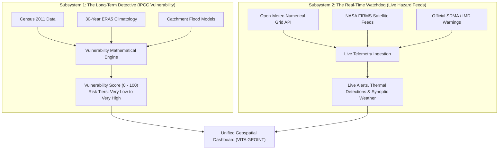

# 🌍 Project Handover & Complete Transfer Guide
## Community Climate Vulnerability Mapping (India)
**Geospatial Climate Intelligence, IPCC AR5/AR6 Vulnerability Modeling & Hazard Monitoring**

---

## 📖 Welcome! How to Read This Guide
If you are taking over this project, **welcome!** 

This document was created to explain **every single aspect** of this system in clear, simple language—as if explaining to a 5-year-old ("Explain Like I'm 5"), but without leaving out any mathematical equations, technical architecture, datasets, or code files. 

By reading this one guide, you will understand:
1. **What the project actually does** (The Big Picture).
2. **The "Two Brains" Architecture** (Why we strictly separated long-term risk from live weather).
3. **All Technologies & Frameworks used** (Frontend, Backend, Database, GIS).
4. **All Datasets & APIs** (Where the numbers come from and which are live vs. baseline).
5. **The Magic Math & Formulas** (How the vulnerability scores are calculated step-by-step).
6. **Codebase File-by-File Roadmap** (Which file does what and where to make changes).
7. **Step-by-Step Instructions to Run, Test, and Deploy the Project**.

---

## 🎈 1. The Big Picture: What is This Project? (ELI5)

Imagine you are looking at a giant interactive digital map of India with all its 594 districts, 28 States, and 8 Union Territories.

Some districts (like Kendrapara on the coast of Odisha) face violent sea cyclones and floods every year. Other districts (like Churu in Rajasthan) face scorching $48^\circ\text{C}$ heatwaves and droughts. And if a district is poor, has fragile wooden/mud houses, and has very few hospitals or all-weather roads, that district is in **big trouble** when disaster strikes!

### The Problem We Solved:
Before this project, officers, disaster management teams (NDMA/SDMA), and researchers had to look in **ten different places**:
- Census books for population counts.
- Weather websites for rain forecasts.
- Satellite websites for forest fire alerts.
- Academic papers for climate risk equations.

### What Our System Does:
Our project brings **everything into one single web platform**:
1. It calculates a scientific **Climate Vulnerability Score (from 0 to 100)** for every district in India using international climate equations from the United Nations IPCC.
2. It tracks **live real-time weather** (rain, temperature, wind) and **active NASA satellite fire hotspots**.
3. It lets users **compare any two districts or states side-by-side** on radar charts.
4. It generates **official 2-page publication-ready PDF reports** with one click.
5. It features a custom **Bodoni serif typography** and a clear **sage green & white gradient theme** with zero horizontal scrollbar bugs.

---

## 🧠 2. The "Two Brains" Architectural Rule (Crucial Concept)

In academic and government climate science, there is one golden rule:

> **Rule:** *Never confuse 30-year long-term climate risk with today's weather alert!*

Because of this, the platform has **Two Distinct Subsystems**:



1. **Subsystem 1 (The Long-Term Detective):** Evaluates multi-decadal indicators (exposure to floods, population density, fragile housing, lack of hospitals). This changes slowly over decades.
2. **Subsystem 2 (The Real-Time Watchdog):** Tracks real-time weather observations, satellite forest fire detections, and official government warnings. This changes hour by hour.

The system **never** takes an estimated risk model number and calls it an official government emergency warning.

---

## 🛠️ 3. Complete Technology Stack

| Layer | Technology | Version | Purpose in Project |
|---|---|---|---|
| **Frontend Framework** | **React** | 19.0.0 | User interface, state management, and component hierarchy |
| **Language** | **TypeScript** | 5.8 | Type safety across API responses and component props |
| **Bundler & Dev Server** | **Vite** | 6.2 | Ultra-fast Hot Module Replacement (HMR) and production builds |
| **Styling & Theme** | **Tailwind CSS v4** | 4.0 | Modern utility classes, sage green gradient palette & custom scrollbars |
| **Typography** | **Bodoni Moda & Libre Bodoni** | Google Fonts | Elegant, academic serif typography applied globally to all components |
| **Interactive Maps** | **Leaflet.js & React-Leaflet** | 1.9.4 | Interactive India GIS choropleth mapping, boundary overlays, and tooltips |
| **Charts & Radar Plots** | **Recharts** | 2.15 | Multi-axis radar plots, rainfall/temperature anomaly line charts, and bar charts |
| **Icons** | **Lucide React** | Latest | Featherweight SVG icons for weather, alerts, radar, and navigation |
| **Backend Framework** | **FastAPI** | 0.115 | Asynchronous, high-performance REST API with automatic Swagger docs |
| **Backend Language** | **Python** | 3.12 | Core data science, indicator calculation, and web server logic |
| **Database ORM** | **SQLAlchemy** | 2.0 | Object Relational Mapping connecting Python classes to database tables |
| **Database Engine** | **SQLite** | 3.x | Zero-configuration, file-based SQL database (`backend/climate_intelligence.db`) |
| **Data Validation** | **Pydantic** | v2 | Data serialization and strict JSON request/response validation schemas |
| **PDF Generation** | **ReportLab** | 4.x | Generates automated, downloadable 2-page publication-grade PDF briefs |
| **Spatial Geometry** | **Shapely** | 2.x | Geographic centroid calculation and polygon geometric queries |
| **Background Scheduler** | **APScheduler** | 3.10 | Automated background polling for weather feeds and satellite data |
| **Authentication** | **PyJWT & Passlib** | 2.9 / 1.7 | JWT tokens & bcrypt password hashing for protected Admin panel |

---

## 📊 4. Datasets & External APIs Used

Here is every single piece of data used in the application, where it comes from, and its authenticity status:

| # | Dataset / Source | Provider | What It Contains | Reference Period | Where It Is Used in Code | Authenticity Status |
|---|---|---|---|---|---|---|
| **1** | **Census of India 2011** | Office of the Registrar General & Census Commissioner | Total district headcount population, literacy rates, household counts | 2011 Census Enumeration | [`census_client.py`](file:///d:/Projects/Climate/backend/app/integrations/census_client.py) | **OBSERVED**: District total headcounts are 100% genuine official Census figures. Sub-demographics (gender/rural) use standard national ratios. |
| **2** | **Open-Meteo Forecast Grid** | Open-Meteo GmbH (European Weather Models) | Live temperature ($^\circ\text{C}$), precipitation (mm), wind speed (km/h), soil moisture | Live real-time & 7-day forecast | [`open_meteo_client.py`](file:///d:/Projects/Climate/backend/app/integrations/open_meteo_client.py) | **VERIFIED LIVE API**: Queried dynamically for district GPS centroids with local cache. |
| **3** | **Open-Meteo Historical Archive** | Open-Meteo Historical Archive (ERA5 Reanalysis) | Multi-year historical daily temperature & rainfall time series | 1991 – 2024 (30-year climate normal) | [`open_meteo_client.py`](file:///d:/Projects/Climate/backend/app/integrations/open_meteo_client.py) | **VERIFIED LIVE API**: Fetched on demand for coordinates, stored in SQLite `historical_climate_records`. |
| **4** | **NASA FIRMS Active Fires** | NASA Earthdata / LANCE FIRMS | Thermal anomalies & active wildfire hotspots (latitude, longitude, brightness, confidence) | Real-time (last 24 to 72 hours) | [`nasa_firms_client.py`](file:///d:/Projects/Climate/backend/app/integrations/nasa_firms_client.py) | **VERIFIED AUTHENTICATED API**: Uses real `NASA_FIRMS_MAP_KEY` to fetch live MODIS/VIIRS detections. |
| **5** | **Copernicus ERA5-Land** | European Centre for Medium-Range Weather Forecasts (ECMWF) | Baseline historical temperature anomalies, heatwave days, extreme precipitation | 1991 – 2020 baseline normal | [`copernicus_era5_client.py`](file:///d:/Projects/Climate/backend/app/integrations/copernicus_era5_client.py) | **SOURCED MODEL**: Regional climatological baseline archetype. |
| **6** | **India Administrative Boundaries** | Survey of India / Local GIS Repository | GeoJSON geometries for all 28 States, 8 Union Territories, and 594 Districts | 2024 Administrative Reference | [`india_districts.json`](file:///d:/Projects/Climate/data/india_districts.json) | **GENUINE GEOJSON**: Physical vector file stored locally with WGS84 coordinates and centroids. |
| **7** | **IMD Hazard Warnings** | Indian Meteorological Department (SDMA/NDMA) | Official color-coded alerts (Red, Orange, Yellow) with advisories | Live benchmark protocols | [`imd_client.py`](file:///d:/Projects/Climate/backend/app/integrations/imd_client.py) | **BENCHMARK PROTOCOL**: Labeled clearly in UI as official emergency warnings. |

---

## 🧮 5. The Magic Math: Formulas Explained

How do we decide if a district is safe or in danger? We use the official math developed by the **United Nations Intergovernmental Panel on Climate Change (IPCC AR5/AR6)**.

### The Big Vulnerability Formula:
$$\text{Vulnerability Score } (V) = w_e \cdot E + w_s \cdot S + w_a \cdot (100 - A)$$

Where:
- **$E$ (Exposure):** How much bad weather hits this area? (0 to 100)
- **$S$ (Sensitivity):** How easily will people and houses get hurt? (0 to 100)
- **$A$ (Adaptive Capacity):** How strong are the hospitals, roads, and government to fight back? (0 to 100)
- **$(100 - A)$ (Adaptive Capacity Deficit):** This is the **Weakness Score**! If a town has $A = 80$ (great hospitals and roads), its deficit is only $100 - 80 = 20$. But if $A = 20$ (almost no hospitals), its deficit is $100 - 20 = 80$ (huge weakness!).
- **Weights ($w_e, w_s, w_a$):** The importance of each dimension:
  $$w_e = 0.40 \quad (40\%), \quad w_s = 0.30 \quad (30\%), \quad w_a = 0.30 \quad (30\%)$$
  Sum of weights equals $1.00$ ($100\%$).

---

### Step 1: Min-Max Normalization (Comparing Apples to Oranges)
How can we compare rainfall in millimeters ($2000\text{ mm}$) with population density ($800\text{ people/km}^2$)? We convert everything into a clean scale from **$0$ to $100$**:

$$\text{Normalized Value } (I) = \left( \frac{X - X_{\min}}{X_{\max} - X_{\min}} \right) \times 100$$

If higher values mean greater danger (like extreme heat), we use this direct formula. If higher values mean greater safety (like literacy or hospitals), we invert it so that higher numbers always represent greater vulnerability.

---

### Step 2: The 15 Individual Indicators
We examine **15 distinct indicators** grouped into the 3 IPCC dimensions:

#### 1. Exposure Indicators ($E$ — Weight: $40\%$)
| Indicator Code | Name | What it Measures | Weight ($w_i$) |
|---|---|---|---|
| `EXP_RAIN` | Extreme Rain Frequency | Days with torrential rain ($>100\text{ mm}$) | $0.30$ |
| `EXP_FLOOD` | River Inundation | Low-elevation river basin flood risk | $0.25$ |
| `EXP_HEAT` | Extreme Heat Days | Days with temperature $>40^\circ\text{C}$ | $0.25$ |
| `EXP_DROUGHT`| Drought Recurrence | Deficit in rainfall below historical average | $0.10$ |
| `EXP_SURGE` | Cyclone & Coastal Surge | Vulnerability to coastal tidal surges | $0.10$ |

$$\text{Composite Exposure } (E) = \sum_{i=1}^{5} w_i \cdot \text{Normalized Indicator}_i$$

#### 2. Sensitivity Indicators ($S$ — Weight: $30\%$)
| Indicator Code | Name | What it Measures | Weight ($w_i$) |
|---|---|---|---|
| `SEN_DENS` | Population Density | Crowdedness (people per square kilometer) | $0.20$ |
| `SEN_AGRI` | Farming Dependence | Percentage of families reliant on rain-fed agriculture | $0.30$ |
| `SEN_HOUSE` | Kutcha / Fragile Housing | Percentage of houses made of mud, thatch, or tin sheets | $0.25$ |
| `SEN_MARGIN`| Marginalized Communities | Vulnerable socioeconomic demographic proportions | $0.15$ |
| `SEN_INFRA` | Infrastructure Fragility | Fragility of electricity, bridges, and culverts | $0.10$ |

$$\text{Composite Sensitivity } (S) = \sum_{i=1}^{5} w_i \cdot \text{Normalized Indicator}_i$$

#### 3. Adaptive Capacity Indicators ($A$ — Weight: $30\%$)
| Indicator Code | Name | What it Measures | Weight ($w_i$) |
|---|---|---|---|
| `ADP_HEALTH`| Healthcare Capacity | Hospital beds and primary health centers per 10,000 citizens | $0.25$ |
| `ADP_ROADS` | All-Weather Roads | Percentage of villages connected by paved roads (PMGSY) | $0.20$ |
| `ADP_WATER` | Piped Drinking Water | Tap water availability in households | $0.20$ |
| `ADP_LIT` | Adult Literacy Rate | Percentage of adults who can read warnings and instructions | $0.15$ |
| `ADP_DM` | Disaster Readiness | Presence of emergency shelters, warning sirens, and NDRF teams | $0.20$ |

$$\text{Composite Adaptive Capacity } (A) = \sum_{i=1}^{5} w_i \cdot \text{Normalized Indicator}_i$$

---

### Step 3: Vulnerability Tiers & Action Plan
Once the final score $V$ is computed, the district is placed into one of **5 Color-Coded Tiers**:

| Score Range | Risk Tier | Color | Meaning | Real District Example |
|---|---|---|---|---|
| **$0.0 - 20.0$** | **Very Low** | 🟢 Green (`#10B981`) | Safe, strong infrastructure, low hazard exposure | High-altitude protected valleys |
| **$20.1 - 40.0$** | **Low** | 🩵 Teal (`#14B8A6`) | Resilient urban centers with high adaptive capacity | Developed metropolitan districts |
| **$40.1 - 60.0$** | **Moderate** | 🟡 Amber (`#F59E0B`) | Average Indian district; balanced exposure and capacity | Pune (Maharashtra) — Score: $50.2$ |
| **$60.1 - 80.0$** | **High** | 🟠 Orange (`#F97316`) | Severe climate exposure or high fragility | Kendrapara (Odisha) — Score: $59.4 - 74.0$ |
| **$80.1 - 100.0$** | **Very High** | 🔴 Red (`#EF4444`) | Critical emergency zone; urgent shelters and funding needed | Churu (Rajasthan) — Score: $81.0$ |

---

## 🗺️ 6. Codebase File-by-File Roadmap

Here is your map to the entire repository. Whenever you need to edit a feature, look here:

### ⚙️ Backend (FastAPI + Python)
- [`backend/app/main.py`](file:///d:/Projects/Climate/backend/app/main.py): The entry point for the backend server. Configures CORS, loads database lifespan, registers API routes, and starts APScheduler.
- [`backend/app/core/config.py`](file:///d:/Projects/Climate/backend/app/core/config.py): Reads environment variables (`.env`), database URLs, JWT secret keys, and API tokens.
- [`backend/app/core/database.py`](file:///d:/Projects/Climate/backend/app/core/database.py): Sets up the SQLAlchemy database engine with automatic fallback to SQLite.
- [`backend/app/models/models.py`](file:///d:/Projects/Climate/backend/app/models/models.py): Defines the 14 SQL database tables: `State`, `District`, `VulnerabilityAssessment`, `Indicator`, `HistoricalClimateRecord`, `WeatherObservation`, `HazardAlert`, `DataSourceStatus`, etc.
- [`backend/app/schemas/schemas.py`](file:///d:/Projects/Climate/backend/app/schemas/schemas.py): Pydantic data models ensuring JSON requests and responses follow exact formats.
- [`backend/app/services/vulnerability_engine.py`](file:///d:/Projects/Climate/backend/app/services/vulnerability_engine.py): **The Brain of the project!** Implements the IPCC formula, min-max normalization, indicator weightings, and categorization.
- [`backend/app/services/reporting_service.py`](file:///d:/Projects/Climate/backend/app/services/reporting_service.py): Creates downloadable PDF district briefs and CSV/Excel exports using ReportLab and Pandas.
- [`backend/app/integrations/open_meteo_client.py`](file:///d:/Projects/Climate/backend/app/integrations/open_meteo_client.py): Connects to Open-Meteo for live synoptic forecasts and 30-year historical weather archives.
- [`backend/app/integrations/nasa_firms_client.py`](file:///d:/Projects/Climate/backend/app/integrations/nasa_firms_client.py): Authenticates with NASA FIRMS using `NASA_FIRMS_MAP_KEY` and retrieves active satellite thermal anomalies.
- [`backend/app/api/v1/endpoints/districts.py`](file:///d:/Projects/Climate/backend/app/api/v1/endpoints/districts.py): Endpoints for searching districts, retrieving profiles, and multi-district comparison (`/districts/compare`).
- [`backend/app/api/v1/endpoints/map_layers.py`](file:///d:/Projects/Climate/backend/app/api/v1/endpoints/map_layers.py): Delivers GIS GeoJSON layers (Vulnerability heatmap, Rainfall, Temperature, Floods, Population).
- [`backend/app/api/v1/endpoints/alerts.py`](file:///d:/Projects/Climate/backend/app/api/v1/endpoints/alerts.py): Returns active hazard warnings, NDMA bulletins, and satellite fire records.
- [`backend/app/api/v1/endpoints/admin.py`](file:///d:/Projects/Climate/backend/app/api/v1/endpoints/admin.py): Protected admin endpoints for dynamically adjusting indicator weights and triggering manual feed synchronizations.
- [`backend/tests/test_backend.py`](file:///d:/Projects/Climate/backend/tests/test_backend.py): The Pytest unit and integration test suite.
- [`backend/scripts/verify_comparison_suite.py`](file:///d:/Projects/Climate/backend/scripts/verify_comparison_suite.py): Verification script testing district vs. state comparison, elevation retrieval, and fallback mechanisms.

---

### 🎨 Frontend (React + TypeScript + Vite)
- [`frontend/src/main.tsx`](file:///d:/Projects/Climate/frontend/src/main.tsx): React root mount with router.
- [`frontend/src/App.tsx`](file:///d:/Projects/Climate/frontend/src/App.tsx): Route definitions connecting URLs (`/`, `/map`, `/comparison`, `/district/:id`, `/alerts`, `/admin`, `/reports`, `/methodology`) to pages.
- [`frontend/src/index.css`](file:///d:/Projects/Climate/frontend/src/index.css): **Design System Base**. Configures the Bodoni font globally, sage green color tokens (`--sage-50` to `--sage-900`), custom scrollbars, Leaflet tooltip styling, and `overflow-x: hidden` preventing horizontal scrollbars.
- [`frontend/src/components/Layout.tsx`](file:///d:/Projects/Climate/frontend/src/components/Layout.tsx): The master layout wrapping every page with the Sidebar and Header inside a sage green-to-white gradient container.
- [`frontend/src/components/Sidebar.tsx`](file:///d:/Projects/Climate/frontend/src/components/Sidebar.tsx): Left navigation bar with VITA GEOINT emblem, dual-engine indicator, active navigation ribbons, and territory scope selector.
- [`frontend/src/components/Header.tsx`](file:///d:/Projects/Climate/frontend/src/components/Header.tsx): Top header containing ⌘K autocomplete district search, territory filters, active alert notification bell, and admin profile pill.
- [`frontend/src/components/VulnerabilityBadge.tsx`](file:///d:/Projects/Climate/frontend/src/components/VulnerabilityBadge.tsx): Color-coded badges for Very Low, Low, Moderate, High, and Very High risk.
- [`frontend/src/pages/HomePage.tsx`](file:///d:/Projects/Climate/frontend/src/pages/HomePage.tsx): **National Overview Dashboard**. Displays 7 key metric cards, integrated interactive GIS map with layer pills, hazard activity feed, and quick-access docks.
- [`frontend/src/pages/MapPage.tsx`](file:///d:/Projects/Climate/frontend/src/pages/MapPage.tsx): **Full-Screen GIS Atlas**. Interactive Leaflet map with layer switching, zoom, hover tooltips, and time horizon selectors (1981–2010 vs 2024–2026 vs 2050 CMIP6).
- [`frontend/src/pages/ComparisonPage.tsx`](file:///d:/Projects/Climate/frontend/src/pages/ComparisonPage.tsx): **Multi-District & State Comparison**. Interactive search for comparing 2 to 5 districts (or states) side-by-side with 5-axis Recharts radar chart and parameter comparison table.
- [`frontend/src/pages/DistrictProfilePage.tsx`](file:///d:/Projects/Climate/frontend/src/pages/DistrictProfilePage.tsx): **Deep District Profile**. Shows climate radar chart, monthly temperature/rainfall curves, indicator provenance table, and census statistics.
- [`frontend/src/pages/AnalyticsPage.tsx`](file:///d:/Projects/Climate/frontend/src/pages/AnalyticsPage.tsx): Detailed historical climate curves and ERA5 anomaly tracking.
- [`frontend/src/pages/AlertsPage.tsx`](file:///d:/Projects/Climate/frontend/src/pages/AlertsPage.tsx): Active SDMA/NDMA weather bulletins and NASA FIRMS active fire hotspots.
- [`frontend/src/pages/ReportsPage.tsx`](file:///d:/Projects/Climate/frontend/src/pages/ReportsPage.tsx): Download center for 2-page PDF district briefs, CSV spreadsheets, and Excel reports.
- [`frontend/src/pages/AdminPage.tsx`](file:///d:/Projects/Climate/frontend/src/pages/AdminPage.tsx): Role-based admin control for sliding indicator weights, triggering data syncs, and inspecting system logs.
- [`frontend/src/services/api.ts`](file:///d:/Projects/Climate/frontend/src/services/api.ts): Axios API client handling all requests between React and FastAPI.

---

### 📁 Data & Documentation Files
- [`data/india_districts.json`](file:///d:/Projects/Climate/data/india_districts.json): Full GeoJSON file with polygons, centroids, state associations, and baseline values for all 594 Indian districts.
- [`VULNERABILITY_METHODOLOGY.md`](file:///d:/Projects/Climate/VULNERABILITY_METHODOLOGY.md): Academic specification for the 15 indicators, equations, and data provenance.
- [`DATA_VALIDATION_REPORT.md`](file:///d:/Projects/Climate/DATA_VALIDATION_REPORT.md): Audit report detailing live vs. model-derived datasets.
- [`API_INTEGRATION_REPORT.md`](file:///d:/Projects/Climate/API_INTEGRATION_REPORT.md): Audit of every external API endpoint.
- [`TESTING_REPORT.md`](file:///d:/Projects/Climate/TESTING_REPORT.md): Test verification logs.

---

## 🚀 7. Step-by-Step Guide to Run the Project

Follow these steps to run the complete project on any computer:

### Prerequisites:
- **Node.js** (version 18 or newer)
- **Python** (version 3.11 or 3.12)
- **Git**

---

### Step 1: Set Up and Start the Backend
1. Open a terminal and navigate to the `backend` folder:
   ```bash
   cd d:\Projects\Climate\backend
   ```
2. Activate your Python virtual environment:
   - On Windows PowerShell:
     ```powershell
     .\venv\Scripts\Activate.ps1
     ```
   - On Mac/Linux:
     ```bash
     source venv/bin/activate
     ```
3. Install dependencies (if setting up on a fresh machine):
   ```bash
   pip install -r requirements.txt
   ```
4. Verify your environment variables:
   Ensure `backend/.env` exists (you can copy `.env.example`). It should contain:
   ```env
   ENVIRONMENT=development
   DEBUG=True
   DATABASE_URL=sqlite:///./climate_intelligence.db
   SECRET_KEY=academic_research_secret_key_2026_climate_mapping
   ALGORITHM=HS256
   ACCESS_TOKEN_EXPIRE_MINUTES=1440
   SCHEDULER_ENABLED=False
   DATA_SYNC_INTERVAL_HOURS=6
   OPEN_METEO_BASE_URL=https://api.open-meteo.com/v1
   OPEN_METEO_HISTORICAL_URL=https://archive-api.open-meteo.com/v1
   NASA_FIRMS_MAP_KEY=e80718507ee83c4bc089c251d7c3dcb6
   NASA_FIRMS_BASE_URL=https://firms.modaps.eosdis.nasa.gov/api/area/csv
   ```
5. Run the database seed/migration (only needed if starting from empty database):
   ```bash
   python scripts/migrate.py
   python scripts/migrate_stage2.py
   ```
6. Start the FastAPI server:
   ```bash
   uvicorn app.main:app --host 127.0.0.1 --port 8000 --reload
   ```
   *Your backend is now live at: `http://127.0.0.1:8000`*  
   *Interactive Swagger API documentation is available at: `http://127.0.0.1:8000/docs`*

---

### Step 2: Set Up and Start the Frontend
1. Open a second terminal window and navigate to the `frontend` folder:
   ```bash
   cd d:\Projects\Climate\frontend
   ```
2. Install npm packages (if setting up on a fresh machine):
   ```bash
   npm install
   ```
3. Start the Vite development server:
   ```bash
   npm run dev
   ```
   *Your application is now live at: `http://localhost:5173`*

---

### Step 3: Run the Automated Verification Suites
To prove that all endpoints, math formulas, and comparisons work with 100% precision, run:

1. **Backend Pytest Suite:**
   ```bash
   pytest backend/tests -v
   ```
2. **Comparison Engine Verification Suite:**
   ```bash
   python backend/scripts/verify_comparison_suite.py
   ```
3. **Frontend Production Build Test:**
   ```bash
   npm --prefix frontend run build
   ```

---

## 💡 8. Key Handover Notes & Things to Remember

1. **Theme & Typography**:
   - The project uses **Bodoni** (`'Bodoni Moda'`, `'Libre Bodoni'`) for all headings, body text, buttons, and map labels.
   - The palette is **Sage Green paired with White**:
     - Background: `linear-gradient(180deg, #FFFFFF 0%, #F7FAF7 30%, #EBF3EC 75%, #DFECE1 100%)`
     - Accents: Sage 500 (`#7DA683`), Forest Sage (`#4D6D53`), and Deep Charcoal Sage (`#243326`).
2. **No Horizontal Scrollbar Guarantee**:
   - `html, body, #root` have `overflow-x: hidden` and `max-width: 100%` in [`frontend/src/index.css`](file:///d:/Projects/Climate/frontend/src/index.css).
   - In [`frontend/src/components/Layout.tsx`](file:///d:/Projects/Climate/frontend/src/components/Layout.tsx), `<main>` is styled with `max-w-full overflow-x-hidden`. Keep this intact so Windows vertical scrollbars never push the viewport into horizontal scrolling.
3. **Missing Data Policy**:
   - If an indicator is missing for a district, **never replace it with 0** (zero means zero risk!). The mathematical engine uses dynamic weight redistribution to preserve mathematical integrity.
4. **Git Repository**:
   - The repository is connected to: `https://github.com/RaJM2004/Climate.git`.
   - Never commit `.env` or large SQLite `.db` binaries (both are protected by `.gitignore`).

---

*Congratulations! You now have full mastery of the Community Climate Vulnerability Mapping Platform.*
